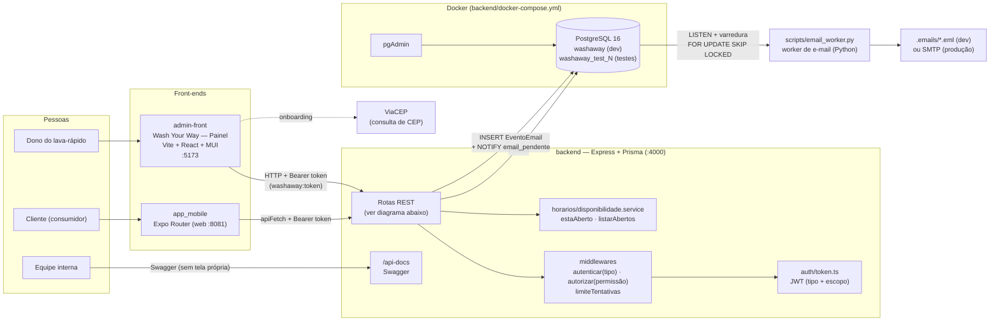
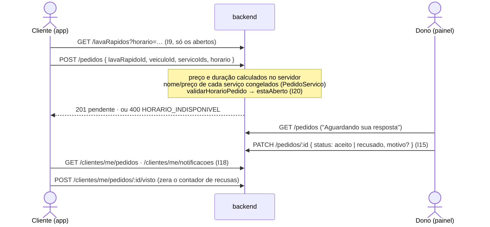
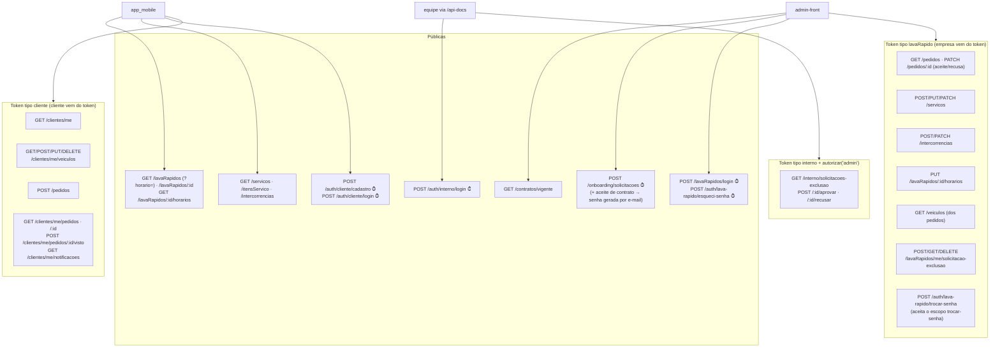
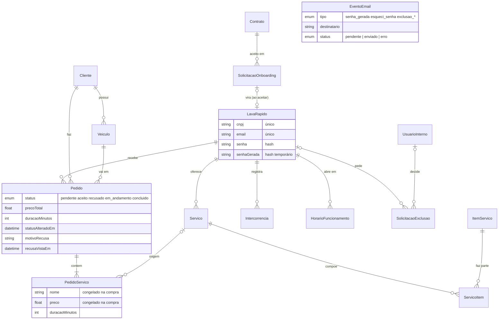
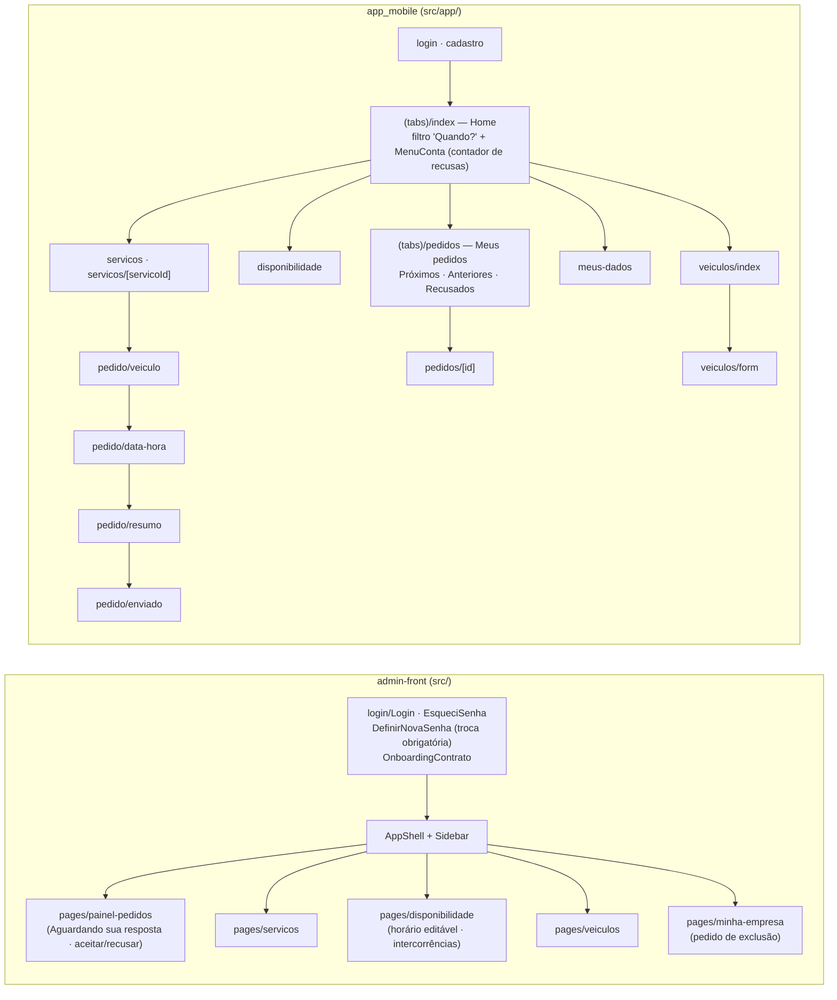

# Arquitetura do WashAway (2026-10-17)

Situação na `main` depois das ondas 1 a 6 da sprint (I1, I2, I3, I9, I13, I15, I17 completo, I18, I19, I20 e I21).

## Visão geral

## Ciclo de um pedido

Status do pedido: `pendente → aceito | recusado`, e `aceito → em_andamento → concluido`. Transição inválida → `409 TRANSICAO_INVALIDA`.

## Rotas do backend e quem pode chamar

⏱ = limite de tentativas (responde 429 com `Retry-After`).
Token ausente ou inválido → 401; tipo errado, escopo `trocar-senha` fora da troca ou falta de permissão → 403; recurso de outra empresa/cliente → 404.

## Modelo de dados (Prisma)

Observações:
- `Pedido → Cliente/Veiculo` usa `onDelete: Restrict`: veículo com pedido não pode ser apagado (`409`), para o histórico do lava-rápido não sumir. Os pedidos antigos foram convertidos pela migration `20261017120000_pedido_cliente_servicos` sem apagar nenhum.
- `SolicitacaoExclusao` guarda nome, CNPJ e e-mail da empresa e sobrevive à exclusão (que apaga o `LavaRapido` em cascata).
- `EventoEmail` é a outbox: gravada na mesma transação da ação que gera o e-mail.
- Fuso fixo `America/Sao_Paulo` (`src/utils/fusoHorario.ts`) para horário de funcionamento, validação de pedido e busca.

## Telas

## Ferramentas de desenvolvimento

| Script | O que faz |
|---|---|
| `scripts/restart.py [--project X]` | Reinicia backend, admin, app e worker (logs em `/tmp/washaway-*.log`) |
| `scripts/test.py --project all\|backend\|admin-front\|app_mobile\|email-worker` | Roda as suítes de teste (backend 514, admin-front 63, app_mobile 155) |
| `npm run prisma:demo` (backend) | Insere dados de demonstração sem apagar nada (inclui o interno `dev@washaway.dev`) |
| `npm run interno:criar -- --email … --permissoes admin` (backend) | Cria um usuário interno |
| `npm run senhas:troca-em-massa` (backend) | Troca, uma vez, a senha `admin` das empresas antigas por senha gerada enviada por e-mail |
